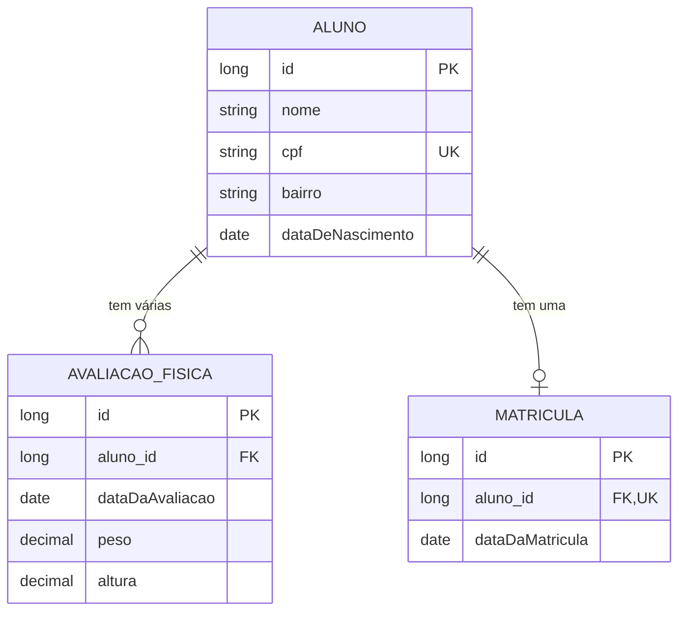

# Academia com Spring Data JPA

API REST de uma academia de ginástica, feita para praticar **mapeamento objeto-relacional (ORM)** com Spring Data JPA e Hibernate: três entidades, dois tipos de associação, consultas derivadas, JPQL e validação.

> Versão completa e mais ambiciosa deste domínio (várias unidades, catraca, aulas com lista de espera, risco de evasão e painel executivo): **[Pulso](https://github.com/barbozadevti/pulso)**.

## Modelo



| Conceito de JPA | Onde está |
|---|---|
| `@Entity`, `@Table`, `@Column` | `modelo/` |
| `@OneToMany` + `cascade` + `orphanRemoval` | `Aluno.avaliacoes` (apagar o aluno apaga as avaliações) |
| `@ManyToOne(fetch = LAZY)` | `AvaliacaoFisica.aluno` |
| `@OneToOne` com coluna única | `Matricula.aluno` (um aluno, uma matrícula) |
| Consulta derivada do nome do método | `findByDataDeNascimento`, `findByAlunoIdOrderByDataDaAvaliacaoDesc` |
| JPQL com `join fetch` (sem N+1) | `MatriculaRepository.buscarPorBairroDoAluno` |
| Dirty checking (UPDATE sem chamar `save`) | `AcademiaService.atualizarAluno` |
| Bean Validation | `Dtos` (`@NotBlank`, `@Pattern`, `@DecimalMin`…) |
| Erros em `application/problem+json` | `TratadorDeErros` |

Fluxo: `Controller → Service → Repository → banco`. Nenhuma entidade sai direto no JSON (DTOs em `Dtos`).

## Rodando

Precisa de **Java 21** e Maven. Por padrão usa H2 em memória, sem instalar banco:

```bash
mvn spring-boot:run
```

- API: http://localhost:8080/api/alunos
- Documentação interativa (Swagger): http://localhost:8080/swagger-ui.html

Com PostgreSQL (`docker compose up -d banco`):

```bash
mvn spring-boot:run -Dspring-boot.run.profiles=postgres
```

## Endpoints

| Método | Rota | O que faz |
|---|---|---|
| POST / GET | `/api/alunos` | cria / lista (filtro `?dataDeNascimento=2000-05-05`) |
| GET / PUT / DELETE | `/api/alunos/{id}` | busca / atualiza / remove (com as avaliações) |
| GET | `/api/alunos/{id}/avaliacoes` | avaliações do aluno, da mais recente para a mais antiga |
| POST | `/api/avaliacoes` | registra avaliação; a resposta traz o **IMC** calculado |
| GET / PUT / DELETE | `/api/avaliacoes/{id}` | busca / atualiza / remove |
| POST / GET | `/api/matriculas` | matricula / lista (filtro `?bairro=Centro`, via JPQL) |
| DELETE | `/api/matriculas/{id}` | cancela a matrícula |

Exemplo:

```bash
curl -X POST localhost:8080/api/alunos -H 'Content-Type: application/json' \
  -d '{"nome":"Marina Souza","cpf":"123.456.789-01","bairro":"Jardim da Penha","dataDeNascimento":"1995-04-12"}'
```

## Testes

```bash
mvn verify
```

7 testes de integração (MockMvc + H2) cobrem CRUD, CPF repetido (409), validação (400), filtro por data, IMC, JPQL por bairro e remoção em cascata.
